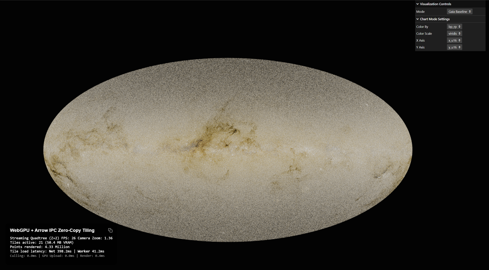
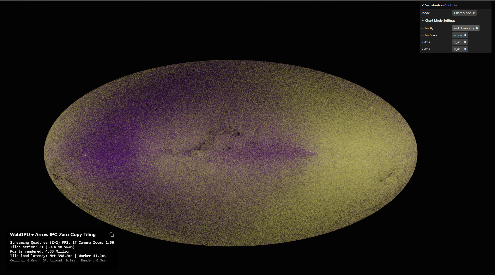
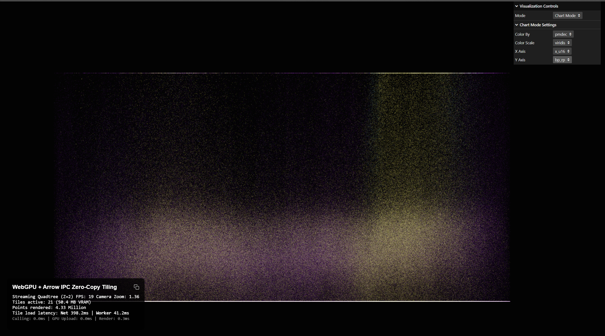
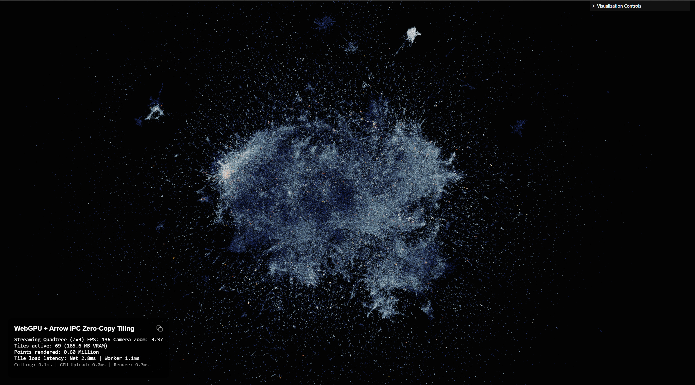
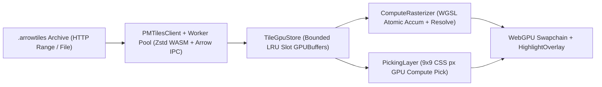

# Deepgraph (`deepgraph`)

[](https://creativecommons.org/licenses/by-nc/4.0/deed.en)

**Deepgraph** is an embeddable, pure-WebGPU billion-point and graph visualization engine for streaming out-of-core **`.arrowtiles` (`v0.1`)** spatial pyramids over HTTP Range requests, local `File` handles, or custom `CustomRangeSource` transports.

Built directly on plain WebGPU compute shaders (`0` Three.js / WebGL dependencies, `0 B` main-thread Arrow parser weight, `~51.0 kB` gzipped bundler entry), Deepgraph renders multi-million to billion-row datasets—verified end-to-end on **`1,348,176,623` ESA Gaia DR3 stars** (`31.81 GiB` archive; `~0.69–0.73s` cold TTFF over `50 ms / 50 Mbps` WAN, `174.8–178.9 FPS` up to `7.22M` active stars on RTX 5090 / `67.4–179.6 FPS` on Intel `xe-lpg` iGPU) and **`2,835,490` LMSys UMAP chat embeddings**—with `0.0000%` stationary shimmer, instant GPU hover/click picking, smooth 2-second WGSL axis transitions, and deterministic GPU memory teardown.

The companion Python + Rust builder, reader, validator, and [`1.35B` hardware crucible benchmark](https://github.com/kai-erlenbusch/arrowtiles/blob/main/docs/BENCHMARK_v011_crucible.md) live in the sibling **[arrowtiles](https://github.com/kai-erlenbusch/arrowtiles)** repository (`pip install arrowtiles`).

---

## Installation & Quick Start

```bash
npm install deepgraph
```

```ts
import { Deepgraph } from 'deepgraph';

if (!Deepgraph.isSupported()) {
  throw new Error('WebGPU is required');
}

const container = document.getElementById('plot')!;
const plot = await Deepgraph.create(container, {
  url: 'https://cdn.example.com/embeddings.arrowtiles',
  encoding: {
    color: { field: 'model', scale: 'viridis' },
    size: { field: 'num_of_tokens', domain: [0, 4096], range: [0.5, 3.0] },
    aggregation: 'points',
  },
});

plot.on('click', (hit) => {
  if (hit) console.log('Selected row:', hit.rowId, hit.attributes);
});
```

For zero-build `<script type="module">` HTML pages, import `deepgraph/standalone` (see [`examples/embed.html`](examples/embed.html) and full reference in [`docs/API.md`](docs/API.md)).

---

## Local Development & Demo App

### Prerequisites
- Node.js 20+
- A WebGPU-capable browser (Chrome 113+, Edge 113+, Safari 18+, or Firefox Nightly)

```bash
git clone https://github.com/kai-erlenbusch/deepgraph.git
cd deepgraph
npm install

# Launch interactive demo app on http://127.0.0.1:5173
npm run dev

# Build library bundles (dist/index.js + dist/standalone.js + .d.ts) and verify consumer types
npm run build:lib
npm run verify:types

# Run Node.js unit tests (worker IPC codec, 1D RTO & ViewState) + fast WebGPU Playwright E2E suite
npm run test:unit
npm run test:e2e
```

> **Note on Sample Archives for Local E2E Tests:** `npm run test:e2e` streams `< 5 MiB` `.arrowtiles` fixtures from the sibling `../arrowtiles/samples/` directory (generated via `python scripts/build_samples.py` in `arrowtiles`). The heavy 5-gate VRAM & LRU stress suite (`npm run test:e2e:heavy`) additionally expects local `public/gaia_full.arrowtiles` and `../arrowtiles/samples/lmsys_d7_proportional_25k.arrowtiles`.

For contributor architecture rules and WebGPU/packaging invariants, see [`AGENTS.md`](AGENTS.md) and [`docs/API.md`](docs/API.md).

---

## Dataset Showcases

### ESA Gaia DR3 Sky Catalogue
- **Scale:** `1,348,176,623` local Gaia DR3 stars (`31.81 GiB` `.arrowtiles` `v0.1` archive; designed for the full `1.8B` survey) streamed via HTTP Range requests
- **Visual Channels:** Galactic Hammer coordinates, `phot_g_mean_mag` / `abs_m` magnitude sizing, additive `R16 / G16 / B16` `bp_rp` optical colour synthesis, HR diagram transitions, and 6D proper-motion star trails





### LMSys Chat Conversations (UMAP Embeddings)
- **Scale:** 2,835,490 conversations across 38 source columns
- **Visual Channels:** UMAP `(x_umap, y_umap)`, categorical `model` / `clusters_14` dictionaries, continuous `num_of_tokens` numeric mode, and on-demand `row_id` point inspection



---

## Architecture Overview



1. **`DatasetSession` & `PMTilesClient`:** Validates `.arrowtiles` `v0.1` headers (`0.x` minor-version & `required_features` gates), prefetches PMTiles leaf directories, and decodes Zstd-compressed Arrow IPC tiles off-main-thread across a Web Worker pool (`@bokuweb/zstd-wasm` + `@uwdata/flechette`, with `256 MiB` Zstd bomb protection and `1D RTO` `BigInt` precision).
2. **`TileGpuStore`:** Manages bounded GPU storage-buffer slots with LRU eviction (`GPUBuffer.destroy()` on eviction and `plot.destroy()`) and Float64 relative-to-center (RTC) coordinate uniforms.
3. **`ComputeRasterizer`:** Commutative, zero-shimmer `2 × u32` atomic WGSL compute splatting across Optical (`R16/G16/B16`), Categorical/Numeric Points (`1,024` levels), Density/Mean-Field KDE, and 6D Star Trails, plus 2-second WGSL axis transitions.
4. **`PickingLayer` & `HighlightOverlay`:** Sub-millisecond `9×9 CSS px` GPU compute hit-testing with priority-aware tie-breaking, instant `32 B` GPU coordinate hover rings, compressed-tile LRU row decoding (`decode_row`), and opt-in async `resolveRowAttributes` sidecar enrichment.

---

## Sibling & Ecosystem Projects

- **[arrowtiles](https://github.com/kai-erlenbusch/arrowtiles)** (`pip install arrowtiles`): DuckDB + Rust (`PyO3`) `.arrowtiles` `v0.1` spatial pyramid builder, reader, validator, and format specification (`docs/SPEC.md`).
- **Python / Jupyter Integration (Planned):** `pydeepgraph` (`pip install pydeepgraph`).

---

## Citing

If you use Deepgraph in academic or scientific work, please cite:

> Erlenbusch, K. (2026). *Deepgraph: WebGPU Billion-Point and Graph Visualization Engine* [Computer software]. https://github.com/kai-erlenbusch/deepgraph

## Licensing

Deepgraph is available free of charge for non-commercial use under the [CC BY-NC 4.0](https://creativecommons.org/licenses/by-nc/4.0/deed.en) public license (see [`LICENSE`](LICENSE) and [`NOTICE`](NOTICE)).

If you're planning to use Deepgraph commercially (including SaaS products, paid applications, consulting deliverables, or internal business tools at for-profit organizations), reach out to [erlenbusch@uchicago.edu](mailto:erlenbusch@uchicago.edu) for a commercial license.

### Data Attribution
- **ESA Gaia DR3:** Gaia data © ESA/Gaia/DPAC (attribution required).
- **LMSys-Chat-1M:** Subject to its upstream dataset terms and is not redistributed in this repository.
